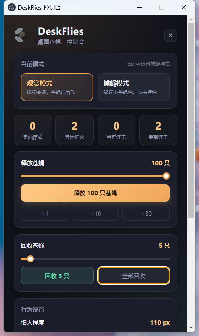
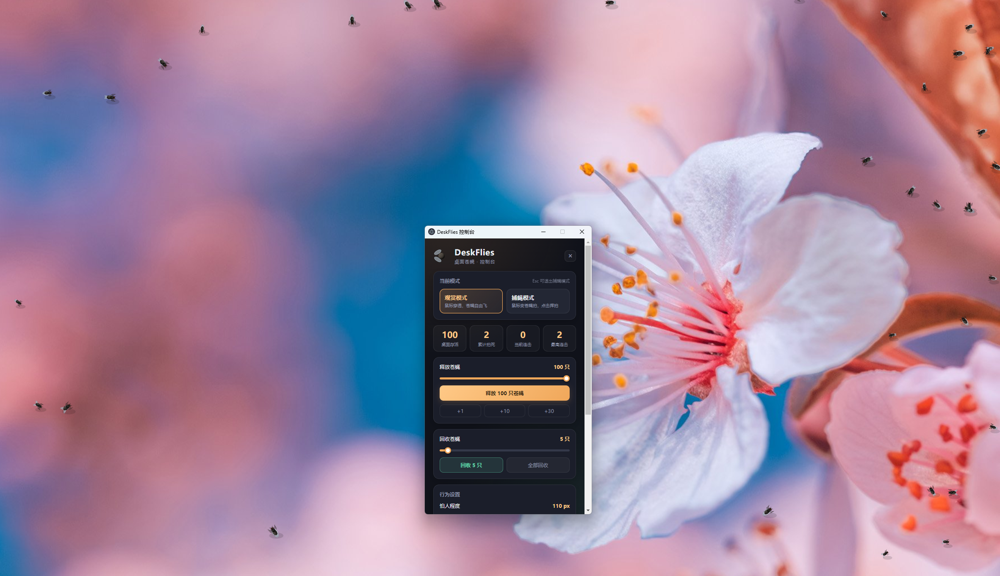

# DeskFlies 桌面苍蝇

在整个桌面释放/回收苍蝇，用苍蝇拍把它们拍掉。透明置顶覆盖层，默认不拦截鼠标，可随时一键清空。

## 实际使用截图

下面的截图来自 Windows 上运行中的 DeskFlies：左侧是控制面板，右侧是桌面苍蝇覆盖层。

<p align="center">
  
  
</p>

## 运行

```bash
npm install
npm start
```

Electron 运行时和打包工具使用 `.npmrc` 配置的官方 GitHub 发布源下载。安装依赖后，可用 `npx electron --version` 确认 Electron 已安装。

## 操作

| 操作 | 方式 |
| --- | --- |
| 打开控制台 | 托盘/菜单栏图标 → 打开控制台，或 `Ctrl/⌘ + Alt + D` |
| 切换观赏 / 捕蝇模式 | `Ctrl/⌘ + Alt + F`，或控制台按钮 |
| 释放苍蝇 | `Ctrl/⌘ + Alt + R`，或控制台滑块 |
| 全部回收并回到观赏模式 | `Ctrl/⌘ + Alt + Shift + X` |

若某个组合被其他软件占用，程序会自动改用备用组合，实际生效的快捷键显示在控制台底部。
| 拍苍蝇 | 捕蝇模式下鼠标左键挥拍；`Esc` 退出捕蝇模式 |

观赏模式下覆盖层完全穿透（Windows 上仍会感知鼠标位置，苍蝇会受惊飞走）；捕蝇模式下鼠标变为苍蝇拍。

## 打包

```bash
npm run dist:win   # Windows: NSIS 安装包 + 便携版
npm run dist:mac -- --universal   # macOS: 支持 Intel 和 Apple 芯片的 dmg + zip
```

Windows 同时生成安装向导和单文件便携版 `DeskFlies-Portable-1.0.0.exe`，后者下载后可直接运行。程序图标使用项目自带的苍蝇图标。输出在 `dist/`。

推送到 `main` 后，GitHub Actions 会分别在 Windows 和 macOS 上构建安装包，并将结果作为工作流附件上传。macOS 构建默认未签名未公证，首次打开需在「系统设置 → 隐私与安全性」中选择「仍要打开」；Windows 未购代码签名证书时可能出现 SmartScreen 提示。

## 已知限制

- 独占全屏游戏等硬件加速全屏窗口可能盖住覆盖层。
- 个别显卡/远程桌面环境下透明窗口可能黑底：启动时加 `--disable-gpu` 可回退。
- macOS 观赏模式下鼠标事件被系统穿透，苍蝇不会感知鼠标惊飞（捕蝇模式正常）。
